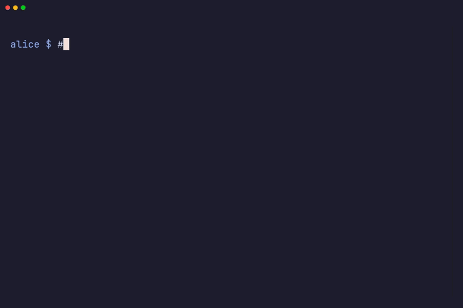

#  murk

[](https://github.com/interrupted-sh/murk/actions/workflows/ci.yaml)
[](https://codecov.io/gh/interrupted-sh/murk)
[](https://crates.io/crates/murk-cli)
[](https://docs.rs/murk-cli)
[](LICENSE-MIT)
[](https://www.bestpractices.dev/projects/12291)
[](https://slsa.dev)

Encrypted secrets manager for developers.

murk stores encrypted secrets in a single `.murk` file that you commit to git. [age](https://age-encryption.org/) encrypts the values, and the key names stay readable. murk works with [direnv](https://direnv.net/) and supports teams. It is one binary with no runtime dependencies.

> murk is pre-1.0 and has not been independently audited. Use good judgment with production secrets.
>
> Deciding whether to adopt it? See [Is murk right for you?](https://murk.interrupted.sh/suitability/) for a suitability matrix and the 0.x release contract.
>
> Some features are experimental: they work, but their behavior or format may still change. [Feature status](https://murk.interrupted.sh/reference/feature-status/) lists what is core and what is experimental.

<p align="center">
  
</p>

## Why

Teams often share `.env` files over chat, which leaves secrets in message history. Vault needs a server. SOPS supports more key backends than murk and has more to configure.

murk is simple: one key on your machine, one encrypted file in your repo. See [THREAT_MODEL.md](THREAT_MODEL.md) for what it protects and what it doesn't.

## How murk compares

| | murk | SOPS | Vault | dotenvx | git-crypt |
|---|---|---|---|---|---|
| Encrypted values, readable keys | Yes | Yes | N/A | Yes | No (whole file) |
| Per-recipient encryption | Yes | Yes | ACL-based | No (shared key) | Yes (GPG) |
| Private per-user overrides | Yes | No | No | No | No |
| Requires a server | No | No | Yes | No | No |
| Cloud KMS required | No | Optional | Typically | No | No |
| Single binary, no runtime | Yes | Yes | Yes (needs a server) | Yes | Yes |
| Built-in direnv integration | Yes | No | No | Not documented | No |
| Recovery phrase | Yes (BIP39) | No | No | No | No |

Compared against each project's documentation as of murk v0.14.0. Other tools change, so check their current docs.

**SOPS** is the closest alternative. Both encrypt values in place and support age. murk adds private per-user values, a single-file vault, built-in team management (`murk circle`) and BIP39 key recovery. SOPS supports more KMS backends and has a larger ecosystem.

**Vault** solves a different problem. It is central infrastructure for secret storage, rotation and dynamic credentials. If you need a secrets server, use Vault. murk keeps encrypted secrets in a repo.

**dotenvx** encrypts `.env` files with one shared key for the whole team. It has no per-recipient encryption, so when someone leaves, everyone needs a new key.

**git-crypt** encrypts whole files through git filters. Its diffs are opaque. Revoking a team member is impractical without re-encrypting git history.

## Install

```bash
brew install interrupted-sh/tap/murk
```

Or via Cargo (requires [Rust toolchain](https://rustup.rs)):

```bash
cargo install murk-cli
```

Or download a pre-built binary (Linux and macOS):

```bash
curl -fsSL https://raw.githubusercontent.com/interrupted-sh/murk/main/install.sh | sh
```

The script checks the archive against the release's `SHA256SUMS`. That catches a corrupt download but not a tampered release. The script then checks the release's build provenance with the [GitHub CLI](https://cli.github.com) (`gh`, logged in with `gh auth login` or `GH_TOKEN`). If a check fails, the install stops.

If `gh` is missing or not logged in, the script asks whether to install anyway (default no). Without a terminal, as in CI or a docker build, it stops unless `MURK_SKIP_ATTESTATION=1` is set on the `sh` side. Set `MURK_TAG=v0.15.0` to install a specific release.

The script installs to `/usr/local/bin` by default. To change that, set one of these variables on the `sh` side of the pipe, for example `... | PREFIX="$HOME/.local" sh`. A variable set before `curl` reaches only `curl`, not the script.

- `PREFIX`: the binary goes to `$PREFIX/bin`.
- `DESTDIR`: a staging root that the script prepends to the path.
- `MURK_INSTALL_DIR`: the exact bin directory. It overrides `PREFIX`.

Pre-built binaries for Linux (x86_64, aarch64, armhf), macOS (x86_64, Apple Silicon) and Windows are on the [releases page](https://github.com/interrupted-sh/murk/releases). On Windows, download the `.zip` from that page.

Binary releases carry [attestations](https://docs.github.com/en/actions/security-for-github-actions/using-artifact-attestations/using-artifact-attestations-to-establish-provenance-for-builds). Verify one downloaded file at a time (this needs `gh auth login`):

```bash
gh attestation verify murk-v0.15.0-aarch64-apple-darwin.tar.gz --repo interrupted-sh/murk \
  --signer-workflow interrupted-sh/murk/.github/workflows/release.yaml \
  --source-ref refs/tags/v0.15.0
```

This works for 0.12.0 and later. Releases 0.10.2 to 0.11.0 were signed as `interrupted-inc/murk`, and 0.3.1 to 0.10.1 as `iicky/murk`. See [VERIFYING.md](VERIFYING.md) to verify older releases and the npm, PyPI and crates.io packages.

murk also has library bindings for Python ([`murk-secrets`](https://pypi.org/project/murk-secrets/)) and Node.js ([`@interrupted/murk-secrets`](https://www.npmjs.com/package/@interrupted/murk-secrets)). They let a program load and decrypt a vault without the CLI, but they do not include the CLI itself. See [Library bindings](https://murk.interrupted.sh/reference/bindings/).

## Quick start

```bash
# Create your key, recovery phrase and vault (asks for your name or email)
murk init

# Add secrets (prompts for the value, hidden input)
murk add DATABASE_URL
murk add OPENAI_KEY

# Keep the local files out of git, then commit the vault
printf '.env\n.murk.lock\n' >> .gitignore
git add .murk .gitignore && git commit -m "add secrets vault"

# Wire up direnv so secrets load automatically on cd
murk env
direnv allow
```

`murk init` writes no `.gitignore`. Its `.env` points at your key, and every write creates an empty `.murk.lock` next to the vault. Neither belongs in git. `murk doctor` warns when `.env` is not ignored.

murk stores your key in `~/.config/murk/keys/` with restricted permissions. murk finds it on its own from the vault's absolute path. That includes a git worktree of the same repo, so a fresh worktree needs no setup. `murk init` also writes a `.env` file with a `MURK_KEY_FILE` line that points at the key (the key itself is not in the repo). Under `MURK_STRICT` or `MURK_AGENT`, `murk init` writes no `.env` and prints no key path. murk does not read `.env`. Use `source .env` if you want the variable in your shell.

Without direnv, use `murk exec`:

```bash
murk exec ./deploy.sh    # runs with all secrets in the environment
```

## How it works

Your `.murk` file has a plaintext header (key names and descriptions, no values) and encrypted values. Anyone can see what secrets exist with `murk info`. Only recipients with their key can read the values.

```bash
murk info           # public schema, works without a key
murk ls             # list key names
murk get KEY        # print a single value
murk export         # shell export statements
```

## Shared, group and private secrets

Each secret has one base tier: shared or a group. It can also have a private value, or only a private value.

**Shared.** `murk add KEY` encrypts the value to every recipient except agent grants. Every authorized team member can decrypt it. Production credentials, API keys and other team-wide secrets live here.

**Group.** `murk add KEY --group NAME` encrypts the value only to the members of a named group, which you create with `murk group create NAME`. Groups are experimental.

**Private.** `murk add KEY --group me` encrypts the value only to your key (murk calls these values motes). During `murk export`, your private value overrides the shared or group value. You can use a local database URL while the rest of the team uses production.

```bash
# Shared: every recipient can read it (prompts for the value, hidden input)
murk add DATABASE_URL

# Private: only you can read it, and it overrides the shared value during export
murk add DATABASE_URL --group me

# Or pipe for scripting (use a command that does not leak to shell history)
pbpaste | murk add DATABASE_URL
```

A vault holds one value for each key. For a different value in development, staging and production, use one vault for each environment (`murk init --vault prod.murk`). Each vault has its own recipients, so production can be for the operations team only. See [Environments](https://murk.interrupted.sh/guides/environments/).

## Teams

```bash
# Alice sets up the vault
murk init
murk add DATABASE_URL

# Bob clones the repo and runs init in it. It prints his public key and signing-key fingerprint
murk init

# Bob can print his signer entry and fingerprint again, to read out to Alice
murk trust --print-key

# Alice adds Bob as a recipient, then commits and pushes .murk
murk circle authorize age1bob... --name bob@example.com

# Bob pulls, trusts the vault once on this machine, and can decrypt
murk trust
murk export

# Bob overrides a value for local dev
murk add DATABASE_URL --group me
```

Each teammate confirms Bob's signing-key fingerprint once, when his first write arrives (see [A new teammate's first write](#a-new-teammates-first-write)). Teammates added with `github:` or `ssh:` skip that step. Every machine also runs `murk trust` once after a fresh clone. A CI runner uses `MURK_TRUSTED_SIGNERS` instead (see [CI/CD](#cicd)).

<p align="center">
  
</p>

## Offboarding

When someone leaves, revoke their access and rotate the secrets:

```bash
murk circle revoke carol --rotate   # remove carol, then rotate what she could read
git commit -am "revoke carol, rotate secrets" && git push
```

A revoke re-encrypts the shared values and the group values you can read. A value held by a group you are not in keeps carol in its ciphertext until a member of that group rotates it. Old versions also remain in git history, and carol can still decrypt any version she could read. Always rotate secrets after a revoke. murk stores only the replacement values. Create new credentials at each provider and invalidate the old ones there.

If you already have the new values in a file, rotate from it in the same step:

```bash
murk circle revoke carol --rotate --values-from .env.rotated
rm .env.rotated               # it holds plaintext secrets
```

murk matches values by name, and each value stays in its tier. The file holds one `KEY=value` line per key. Put a multi-line value, such as a PEM key, in double quotes (`KEY="..."`). Otherwise murk refuses the whole file. It also refuses a file that names a key twice or names a key that cannot be rotated. After any of these refusals, nothing is written and carol is not revoked. Keys the file leaves out stay listed by `murk rotate --list`. The same file rules apply to `murk rotate --values-from` and `murk agent revoke --rotate --values-from`.

<p align="center">
  
</p>

## Git worktrees

A fresh worktree checks out tracked files and nothing else. Every gitignored `.env` you depend on is missing, which is why worktree setups usually copy or symlink one in. murk needs neither. The vault is committed, so it arrives with the checkout. The key was never in the repo, and murk finds it through a sibling checkout of the same repository.

```bash
git worktree add ../murk-feature-x
cd ../murk-feature-x
murk exec ./deploy.sh   # works at once, nothing to provision
```

Only real worktrees of the repo count: murk checks them against git's own metadata. A copy of the vault elsewhere on disk gets no key. While `MURK_STRICT` or `MURK_AGENT` is set, murk does not look up a stored key at all, so an agent in a worktree needs its own scoped grant. See [docs/ai-agents.md](docs/ai-agents.md).

## Trusting a vault

A `.murk` file lists its own recipients, so a valid signature alone doesn't say the signer is someone you trust. murk checks every vault against a trust pin on your machine (`~/.config/murk/signer-pins/`, outside the repo, shared by every git worktree of the repo). The first load on each machine is refused until you review the vault and accept it:

```bash
git log -p -- .murk   # who changed the vault
murk diff ORIG_HEAD   # after a pull: the changes it brought in
murk trust            # shows the signer, its signing-key fingerprint and every recipient, then asks (--yes for scripts)
```

A plain `murk diff` compares with `HEAD`, which already holds the pulled vault, so it shows nothing after a pull. git sets `ORIG_HEAD` to your commit from before the pull or merge, also when it fast-forwards. So run `murk diff ORIG_HEAD` right after the pull, before another pull, merge, rebase or reset moves it. A fresh clone has no earlier commit, and a newly authorized teammate's key cannot open the revisions from before they were authorized. In those cases, read `git log -p -- .murk` and what `murk trust` prints.

murk refuses a vault that:

- is unsigned, when your key can sign or `MURK_TRUSTED_SIGNERS` is set
- was signed when you last accepted it and now is not
- is signed by a key this machine does not trust, or by an agent grant
- is another vault's file
- is older than one already accepted on that branch
- changes a group without a member's signature

The message says what murk saw. For most refusals, `murk trust` accepts the vault after you review it. A few need you to restore the file from git instead: a vault signed by an agent grant, a forged signing key, a counter above the largest murk accepts, or another vault's unsigned pre-0.14 file. To revert a branch on purpose, restore the old file, run `murk trust`, then make any write. If murk cannot write its pin (a read-only home), it warns and carries on. [Recipients & signatures](https://murk.interrupted.sh/concepts/recipients-signatures/#trusting-a-signer) lists every refusal.

Hardware, plugin and `ssh-rsa` keys cannot sign, so their writes are unsigned. A signing teammate reviews them and runs `murk trust`, which re-signs the vault.

### A new teammate's first write

A new teammate with an age key is confirmed once on every other machine. Their first signed write carries a signing key your machine has never seen. murk refuses it once ("a trusted recipient whose signing key this machine has not confirmed yet") and shows the key's fingerprint. To confirm it:

1. The teammate runs `murk trust --print-key` to see their own fingerprint. `murk init` prints it too, before they are authorized.
2. You compare the two fingerprints over a channel other than the repo.
3. You run `murk trust`.

This is trust on first use. The key comes from the vault, so the fingerprint check is what makes it trustworthy. Once a machine that confirmed the key writes, its signed vault carries the key. Machines that load that vault learn the key without another prompt. murk refuses a different key for a signer whose key is already pinned as a forgery, and `murk trust` does not accept it. `ssh-ed25519` teammates (for example `murk circle authorize github:user`) need no confirmation, because their recipient string is their verifying key.

### Upgrading to 0.14

Every teammate and CI runner needs 0.14, because a 0.14 save uses a signature format that 0.13 refuses. On each machine, the first load of an existing vault is refused once. Review it and run `murk trust`. Then make the first 0.14 save on the default branch and merge it into your other branches.

murk refuses a vault signed by 0.13 only on a branch where this machine has accepted or saved a 0.14 vault, so one worktree's save does not lock the others out. A branch gets that mark when this machine saves there (a merge alone does not count). Until then, its 0.13 vault loads as history. Once the machine has seen a 0.14 vault, that history is read-only. murk refuses every write over it until you run `murk trust` on that copy (review it first) or merge the upgrade from the default branch.

A vault written by 0.13 gets an id derived from its creation time and name, so teammates who upgrade on different days agree on it. CI sets `MURK_TRUSTED_SIGNERS` (see [CI/CD](#cicd)). Re-run `murk setup-merge-driver` in each clone so the merge driver gets the vault path.

## CI/CD

[](https://github.com/marketplace/actions/murk-action)

Use [murk-action](https://github.com/interrupted-sh/murk-action) to decrypt secrets in GitHub Actions workflows. Give CI a scoped grant and store its whole key file as one secret:

```bash
murk agent grant --name ci-deploy --only DEPLOY_TOKEN --ttl 30d --out - | gh secret set MURK_KEY
git commit -am "grant ci-deploy" && git push
```

```yaml
steps:
  - uses: actions/checkout@v4
  - uses: interrupted-sh/murk-action@v1
    with:
      murk-key: ${{ secrets.MURK_KEY }}
  - run: ./deploy.sh  # DEPLOY_TOKEN is now in the environment
```

This needs murk-action v1.2.0 or later, which `@v1` gives. The key file carries its own trusted signers and expiry, so CI needs nothing else. Renew it before it expires: run the same command with `--renew`, then commit and push.

A CI runner has no trust pin and nobody to run `murk trust`. Any key other than a grant key file, such as a bare key line or a full key, needs `MURK_TRUSTED_SIGNERS`. This variable lists the people who write the vault, separated by commas or newlines:

- An age signer is `age1...:<verifying key>`. A bare `age1...` key without its verifying key is an error.
- An `ssh-ed25519` signer is its public key line.
- Each signer runs `murk trust --print-key` to get their entry. The entry goes to stdout and the fingerprint to stderr.

Store the value as a secret next to `MURK_KEY`. Set it only from a CI secret or the real process environment, never from a file in the repository or a `.env` that an app's dotenv loader reads, because it decides which signers the machine trusts. Pass it as murk-action's `trusted-signers` input, or in the step's `env:` on a murk-action older than v1.2.0. A later step that runs `murk` itself needs both variables in its own `env:`.

With the variable set, murk refuses an unsigned vault even for a key that cannot sign. The variable never adds to what the machine's own pin trusts. See the [CI/CD guide](https://murk.interrupted.sh/guides/cicd/).

The organization was renamed from `interrupted-inc` to `interrupted-sh`. Change any workflow that still uses `interrupted-inc/murk-action` to `interrupted-sh/murk-action`.

Store your `MURK_KEY` as a GitHub Actions secret. Decrypted values are registered with GitHub's log masking, but masking depends on GitHub's runner behavior and is not a hard security boundary.

## Recovery

When `murk init` generates a key, it prints a 24-word recovery phrase that encodes that key. Write it down.

```bash
# Lost your key? Print it from the phrase (prompts, hidden input) and save it
mkdir -p -m 700 ~/.config/murk
(umask 077 && murk restore > ~/.config/murk/restored.key)
export MURK_KEY_FILE=~/.config/murk/restored.key
```

`murk restore` only prints the key. It writes no file. Save the output to a file with mode 600 and point `MURK_KEY_FILE` at it. The phrase covers age keys only, not SSH or hardware keys.

## Commands

### Setup and recovery

| Command | Description |
|---------|-------------|
| `murk init` | Create a vault and key, or reuse your existing key |
| `murk env` | Write a `.envrc` for direnv integration |
| `murk restore` | Print the key encoded by a BIP39 phrase |
| `murk recover` | Show recovery phrase for current key |

### Secrets

| Command | Description |
|---------|-------------|
| `murk add KEY [--group me]` | Add or update a secret (prompts for the value). `--group NAME` is experimental |
| `murk generate KEY [--hex] [--length N]` | Generate a random secret and store it |
| `murk rotate KEY [--generate]` | Rotate a secret with a new value |
| `murk rotate --all` | Rotate all secrets (prompts for each) |
| `murk rotate --list [--json]` | List the secrets that need rotation (overdue, expiring, post-revoke) |
| `murk rm KEY` | Remove a secret |
| `murk get KEY` | Print a single decrypted value |
| `murk edit [KEY] [--group me]` | Edit secrets in `$EDITOR` (experimental) |
| `murk ls` | List key names |
| `murk export` | Print all secrets as shell exports |
| `murk import [FILE]` | Import secrets from a .env file |

### Metadata

| Command | Description |
|---------|-------------|
| `murk describe KEY "..."` | Set description for a key |
| `murk info` | Show public schema (no key required) |
| `murk skeleton` | Export schema-only vault with no secrets or recipients |

### Run

| Command | Description |
|---------|-------------|
| `murk exec CMD...` | Run a command with secrets in the environment (`--only`, `--clean-env`). Refuses keys named like loader, shell, proxy or murk variables (`PATH`, `LD_*`, `GIT_*`, `*_PROXY`, `MURK_*`, ...) unless `--allow-reserved` |

### Agents

| Command | Description |
|---------|-------------|
| `murk agent plan` | Emit schema-only context for AI agent prompts (no key required) (experimental) |
| `murk agent exec --only KEY -- CMD...` | Run a command with strict agent-safe defaults: clean env, no `MURK_KEY`, injected values masked in the output. It refuses any key that is not an agent grant, your own included, unless you pass `--allow-operator-key`, so supply a grant key (experimental) |
| `murk agent grant --name NAME --only KEY [--ttl DUR]` | Mint a scoped key with murk-enforced expiry that reads only the named secrets. `--ttl` defaults to 2h. Reads fail closed after the TTL. Revoke the grant to close it for good (experimental) |
| `murk agent init --name NAME --only KEY` | Set the agent allow-list, mint a grant and print how to run the agent (experimental) |
| `murk agent connect [CLIENT] --only KEY` | Wire `murk mcp` into an AI editor's MCP config with a scoped grant (experimental) |
| `murk agent disconnect [CLIENT] [--rotate]` | Remove murk from an AI editor's MCP config (`--rotate` also revokes the grant and rotates its keys) (experimental) |
| `murk agent ls` | List active agent grants and their TTLs (experimental) |
| `murk agent revoke NAME [--rotate]` | Revoke a grant (`--rotate` also rotates the secrets it could read) (experimental) |
| `murk mcp [--allow-exec]` | Run a stdio MCP server exposing scoped secrets to AI agents (needs a grant + `MURK_AGENT`) (experimental) |
| `murk policy show\|set\|clear` | Manage the agent allow-list (tags agents may receive) (experimental) |

### Recipients and groups

| Command | Description |
|---------|-------------|
| `murk circle` | List recipients |
| `murk circle authorize PUBKEY [--name NAME] [--allow-ssh-rsa]` | Add a recipient: an age key, `ssh:path` or `github:user` (`github:` is experimental). An SSH recipient decrypts only with `MURK_KEY_FILE` pointing at its unencrypted private key. murk does not search `~/.ssh` |
| `murk circle revoke RECIPIENT` | Remove a recipient |
| `murk group create NAME` | Create a named recipient group (encrypt a secret to a subset) (experimental) |
| `murk group ls` | List groups and their members (experimental) |
| `murk group add NAME --member M` | Add a member to a group (you must be a member of it) (experimental) |
| `murk group rm NAME [--member M]` | Remove a member, or delete the group (you must be a member of it) (experimental) |

### Checks

| Command | Description |
|---------|-------------|
| `murk verify` | Check vault integrity, signature, trust, recipients and key access (needs a key, prints no secret values) |
| `murk trust [--yes]` | Show who signed the vault and what changed, then trust it on this machine (re-signs an unsigned vault with your key). `murk trust --print-key` prints your own signing-key fingerprint and your `MURK_TRUSTED_SIGNERS` entry |
| `murk doctor` | Scan the surrounding repo for hygiene issues |
| `murk scan [PATHS...]` | Scan files for leaked secret values |

### Git

| Command | Description |
|---------|-------------|
| `murk diff [REF] [--show-values] [--json]` | Show secret, recipient and signer changes since a git ref. Prints key names only, unless you pass `--show-values`. murk checks the old revision's MAC and signature before it shows anything from it. It judges that revision's signer by looser rules than a load: any signer this machine ever trusted is accepted, with no rollback, group-change or downgrade check. With no trust pin and no `MURK_TRUSTED_SIGNERS`, it shows the revision under a "not trusted on this machine" warning, and `MURK_STRICT` refuses it (experimental) |
| `murk setup-merge-driver` | Configure git to merge `.murk` vaults: the driver verifies both sides and signs the result (experimental) |

### Shell

| Command | Description |
|---------|-------------|
| `murk completion generate\|install SHELL` | Generate or install shell completions |

Every vault command accepts `--vault FILE` (or `MURK_VAULT`, default `.murk`), so one repository can hold a vault for each environment (see [Environments](https://murk.interrupted.sh/guides/environments/)). `ls`, `export`, `info`, `exec` and `agent plan` filter by `--tag`. `ls`, `export`, `info`, `diff` and `agent plan` support `--json`. See `murk <command> --help` for the full flag list, or [docs/cli-reference.md](docs/cli-reference.md) for the complete reference (generated from the binary, so it stays in sync).

## Pre-commit hooks

murk provides a [pre-commit](https://pre-commit.com/) hook to scan staged files for leaked secret values. Add it to your project's `.pre-commit-config.yaml`:

```yaml
repos:
  - repo: https://github.com/interrupted-sh/murk
    rev: v0.15.0  # run 'pre-commit autoupdate' to move to a newer tag
    hooks:
      - id: murk-scan
```

Then install the hook:

```bash
# Install pre-commit if needed
pip install pre-commit

# Install the hook into your repository
pre-commit install
```

Before each commit, the hook runs `murk scan` on the staged files. It fails the commit if it finds a leaked secret value. The hook needs murk on PATH, a `.murk` vault in the repository and a key that can read the vault on a machine that trusts it. It checks only the values that key can read, and it skips values shorter than 8 characters.

To manually run on specific files:

```bash
pre-commit run murk-scan --files <file1> <file2>
```

To run on all files:

```bash
pre-commit run murk-scan --all-files
```

## Design

- **age for encryption, Ed25519 signatures for integrity.** murk uses no custom cryptographic primitives. A BLAKE3 MAC binds the ciphertexts, and an Ed25519 signature authenticates the writer. An age key signs with an Ed25519 key derived from the age secret, and the vault's signer registry publishes its verifying key. An `ssh-ed25519` key signs directly.
- **Trust is pinned per machine.** Each machine accepts a vault only from signers it trusts, and it pins each signer's verifying key. `murk trust` records the pins, or `MURK_TRUSTED_SIGNERS` supplies them, so murk refuses a vault that an attacker wrote or replayed. A trusted signer can still change values and recipients, by design. A key that cannot sign (hardware, `ssh-rsa`) writes an unsigned vault, so those teams rely on git commit signing. See [THREAT_MODEL.md](THREAT_MODEL.md).
- **Git is the audit trail.** murk does not replicate what git does.
- **The header is public, values are private.** Key names are visible, values are not.
- **Explicit over magic.** murk never silently overwrites or destroys data.

The `.murk` file is designed to be committed. Key names are readable and each value is encrypted on its own. This abridged illustration is not a loadable vault (see [SPEC.md](SPEC.md) for the full format):

```json
{
  "version": "3.0",
  "created": "2026-01-01T00:00:00Z",
  "vault_name": ".murk",
  "recipients": ["age1abc..."],
  "schema": {
    "DATABASE_URL": { "description": "Production database" },
    "STRIPE_SECRET": { "description": "Stripe secret key" }
  },
  "secrets": {
    "DATABASE_URL": { "shared": "<base64 age ciphertext>" },
    "STRIPE_SECRET": { "shared": "<base64 age ciphertext>" }
  },
  "meta": "<base64 age ciphertext>",
  "sig": { "signer": "age1abc...", "v": 2, "sig": "<base64 ed25519 signature>" }
}
```

See [SPEC.md](SPEC.md) for the full specification.

## Security notes

**Shell history.** `murk add` and `murk restore` prompt with hidden input. Prefer them over passing secrets as arguments or through `echo`, which can leak to shell history. When you pipe from a script, use a command that does not record to history (for example `pbpaste | murk add KEY`, or read from a file).

**Command output.** `murk get KEY` prints the decrypted value to stdout. Run interactively, the value lands in your terminal and its scrollback. Strict mode refuses to write it to a regular file, but it does not block a terminal. Pipe the value into the program that needs it instead of reading it on screen.

**Strict mode and agent context.** `MURK_STRICT` turns on a short list of checks: no stored-key lookup, RAM-backed scratch space for `murk edit`, no `get`, `export` or `murk diff --show-values` output to a regular file, no result that no key checked, and no `murk diff` of a revision it could only show with a warning. It does not guarantee that no plaintext reaches disk. Agent context (`MURK_AGENT`, which `murk agent exec` sets on its child) always turns strict mode on. See [docs/env-reference.md](docs/env-reference.md).

**Editing.** `murk edit` writes the decrypted values to a temporary plaintext file for `$EDITOR`, then overwrites and deletes it. See [SECURITY.md](SECURITY.md) for what can survive.

**Secret names are plaintext.** The `.murk` header shows secret names (for example `STRIPE_SECRET_KEY`, `DATABASE_URL`) so that `murk info` works without a key and git diffs stay readable. Only values are encrypted. If your threat model requires hiding which services you use, murk does not do that.

**Key storage.** Your secret key lives in `~/.config/murk/keys/` with mode 600, outside your repository. The `.env` file in your project holds only a `MURK_KEY_FILE` line with this path, not the key. This is like SSH keys in `~/.ssh`, except that murk also passes secrets to child processes through `export` and `exec`.

**A compromised machine.** If a machine that holds your key is compromised, replace the key:

1. Another recipient runs `murk circle revoke YOUR_NAME --rotate`, then commits and pushes. This removes your old key and rotates what it could read.
2. On each machine you keep using, delete your old key file from `~/.config/murk/keys/`.
3. Clear the old key from your shell: run `unset MURK_KEY MURK_KEY_FILE`. Until step 5, do not `source .env`, and do not let direnv load it if your `.envrc` reads `.env`. murk uses these variables before any stored key. A `MURK_KEY_FILE` that points at the deleted file makes `murk init` fail, and an old `MURK_KEY` makes it reuse the compromised key.
4. Run `murk init` in the repo. It asks to replace the `MURK_KEY_FILE` line in `.env`. Answer yes. It prints a new public key.
5. Load the new pointer, for example with `source .env`.
6. A recipient authorizes the new key with `murk circle authorize`, then commits and pushes. Teammates confirm its fingerprint on your first write (see [A new teammate's first write](#a-new-teammates-first-write)).

**Hardware-backed keys.** For stronger protection, point `MURK_KEY_FILE` at an age plugin identity file (YubiKey, Apple Secure Enclave, FIDO2 and others). The private key then lives in hardware and never exists as bytes on disk (the FIDO2 plugin is the exception). See [Hardware identities](#hardware-identities) below.

**Shared secrets are readable by every recipient except agent grants.** Any other recipient can decrypt every secret in the shared tier. Schema fields such as tags do not restrict human recipients. For narrower access, assign a secret to a named group (encrypted to that group's members) or set a private value for one recipient (`--group me`).

**Reserved variable names.** Whoever last wrote the vault chooses its key names. So `murk export`, `murk exec` and `murk agent exec` refuse to set variables that change how programs, shells or murk itself run:

- the names `PATH`, `HOME`, `NODE_OPTIONS`, `BASH_ENV`, `EDITOR` and `RUSTFLAGS`
- anything ending in `_PROXY`
- anything starting with `LD_`, `DYLD_`, `GIT_`, `BASH_FUNC_`, `PYTHON`, `PERL`, `RUBY`, `JAVA_`, `_JAVA_`, `JDK_`, `DOTNET_`, `CARGO_`, `RUSTC`, `SSL_`, `PIP_`, `GEM_`, `BUNDLE_`, `NPM_CONFIG_`, `LUA_`, `XDG_`, `DIRENV_` or `MURK_`

The match ignores case, and `NODE_ENV` is not reserved. [Environment variables](https://murk.interrupted.sh/concepts/env-vars/#variable-names-a-vault-may-not-set) has the full list. Review who added the key, then pass `--allow-reserved` if you mean it. The MCP `murk_exec` tool never allows them.

**AI agents.** If you use murk with AI coding agents, see [docs/ai-agents.md](docs/ai-agents.md) for safe patterns.

See [THREAT_MODEL.md](THREAT_MODEL.md) for the full threat model.

## Hardware identities

> Hardware and plugin identities are experimental. See [Feature status](https://murk.interrupted.sh/reference/feature-status/).

By default `murk init` generates a raw age key and stores it under `~/.config/murk/keys/`. That is fine for development, but the key lives on disk as plaintext. Anyone with read access to the file can decrypt everything.

For production use, point `MURK_KEY_FILE` at an [age plugin identity file](https://github.com/FiloSottile/age#plugins) so the private key lives in tamper-resistant hardware (the FIDO2 plugin is the exception, see the table) and only consents to decrypt with a physical action (touch, Touch ID, PIN):

| Hardware | Plugin |
| --- | --- |
| YubiKey 4 and 5 (other PIV tokens with a P-256 key may work) | [`age-plugin-yubikey`](https://github.com/str4d/age-plugin-yubikey) |
| Apple Secure Enclave (Touch ID) | [`age-plugin-se`](https://github.com/remko/age-plugin-se) |
| FIDO2 key with `hmac-secret` (experimental, and the identity is held in memory while decrypting) | [`age-plugin-fido2-hmac`](https://github.com/olastor/age-plugin-fido2-hmac) |
| OpenPGP Card | [`age-plugin-openpgp-card`](https://crates.io/crates/age-plugin-openpgp-card) |

Example setup with a YubiKey:

```bash
# Install the plugin. It must be on $PATH because murk runs it to encrypt and to decrypt.
brew install age-plugin-yubikey

# Create an identity on the YubiKey. The plugin asks for the PIV PIN
# (default 123456) and a touch. --touch-policy always asks for a tap on every
# decrypt. --pin-policy once asks for the PIN once per session.
mkdir -p ~/.config/murk
age-plugin-yubikey --generate --touch-policy always --pin-policy once \
  > ~/.config/murk/yubikey.txt

# murk refuses identity files that others can read
chmod 600 ~/.config/murk/yubikey.txt

# Authorize the YubiKey while you still use your current key
murk circle authorize "$(grep -i recipient ~/.config/murk/yubikey.txt | awk '{print $NF}')"

# Switch to the YubiKey. murk does not read .env, so export the variable.
unset MURK_KEY
export MURK_KEY_FILE="$HOME/.config/murk/yubikey.txt"

# Read a secret. The YubiKey blinks. Tap it to decrypt.
murk get SOME_KEY
```

To keep using the YubiKey in new shells, put that `export` in your shell profile, or in `.env` if you load it with `source .env`. `murk init` wrote a `MURK_KEY_FILE` line to `.env` for your software key. Remove or replace it so a later `source .env` does not switch you back.

The identity file contains a `#    Recipient: age1yubikey1...` header followed by an `AGE-PLUGIN-YUBIKEY-1...` pointer. murk reads the pubkey from the header without calling the plugin. murk runs the plugin when it decrypts with this identity, and when it encrypts to a YubiKey recipient. A save encrypts to every recipient, so anyone who writes the vault needs the plugin on `$PATH`. Decryption is when the YubiKey asks for a tap.

If the plugin binary is not on `$PATH`, murk fails with `age-plugin-yubikey unavailable`. Install the plugin and retry. `MURK_KEY` (the inline env var) rejects `AGE-PLUGIN-...` strings, because a bare plugin identity does not carry the recipient pubkey. Use `MURK_KEY_FILE` pointing at the identity file instead.

**No BIP39 recovery for hardware identities.** The point of hardware-backed keys is that the raw key bytes stay on the device (the FIDO2 plugin is the exception), so there are no bytes to encode as a recovery phrase. Instead, enroll a second hardware device at setup and add both pubkeys as recipients (`murk circle authorize <backup-pubkey>`). If you lose one, the backup still decrypts.

**`MURK_KEY` vs `MURK_KEY_FILE`.** Setting `MURK_KEY` to a raw `AGE-SECRET-KEY-1...` string in `.env` works once your shell loads that file, but the key is then plaintext on disk. Prefer `MURK_KEY_FILE` pointing at either a file under `~/.config/murk/keys/` (convenience) or a hardware-backed plugin identity file (strongly recommended for production). Set one, not both: murk refuses to run when both are non-empty, and treats an empty value as unset.

## License

MIT OR Apache-2.0
