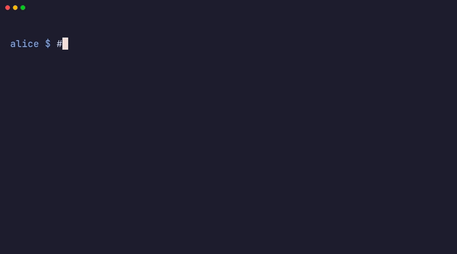

[direnv](https://direnv.net/) loads and unloads environment variables
according to your current directory. murk supports direnv, so your secrets
load when you `cd` into a project. You need no manual `export` and no
wrapper script.



## Setting it up

```bash
murk env
direnv allow
```

`murk env` writes a `.envrc` that runs `murk export` for your vault.
`direnv allow` tells direnv that it can run that `.envrc`. direnv needs this
opt-in for each directory, so that a repository you do not trust cannot set
environment variables when you `cd` into it.

After that, direnv exports every secret you can read when you enter the
project. That includes shared secrets, group secrets and your own `me`
overrides. direnv unsets them when you leave.

## Keeping up with vault changes

direnv reloads when `.envrc` changes, not when `.murk` changes. After
`git pull` or `murk rotate`, run `direnv reload`. To make direnv watch the
vault, add this line above the `eval` line in `.envrc`:

```bash
watch_file .murk
```

## The first load on a new machine

Before the first load on a machine, murk can stop with "not trusted on this
machine yet". Review the vault and run `murk trust` once, as described in
[working in teams](/guides/teams/#trusting-the-vault-on-a-new-machine). Then
run `direnv allow` as usual.

## Variable names murk will not export

murk does not export a variable that changes how programs, your shell or
murk itself run, such as `PATH`, `LD_PRELOAD`, `GIT_*`, `HTTPS_PROXY` and
`MURK_*`. Otherwise the `.envrc` would let the last writer of the vault
make that choice. So `murk export` stops and names the key. See [Variable
names a vault may not set](/concepts/env-vars/#variable-names-a-vault-may-not-set)
for the list and for `--allow-reserved`.

## Where the key lives

murk keeps your private key in `~/.config/murk/keys/`, outside the
repository, with restricted permissions. The CLI finds it from the absolute
path of the vault. So under direnv, the repository holds nothing about the
key, and the `.envrc` only runs `murk export`.

`murk init` also writes a `.env` for shells that do not use direnv. It holds
a `MURK_KEY_FILE` line with the path to your key file, never the key itself,
so `source .env` works too. That path is specific to your machine, so keep
`.env` in `.gitignore`. `murk doctor` warns when git does not ignore `.env`.

:::caution
Never put `MURK_TRUSTED_SIGNERS` in `.env` or in any other file in the
repository. The variable decides which signers this machine trusts. The murk
CLI does not read `.env` itself. But `source .env`, a `dotenv` line in
`.envrc`, or an app's dotenv loader puts the file's variables into the
environment that murk and the murk bindings read. Then whoever can change the
file chooses the signers.
:::

## Without direnv

If you prefer not to use direnv, `murk exec` gives the same result for a
single command, without secrets in your shell environment:

```bash
murk exec -- ./deploy.sh    # runs with all secrets in the environment
```

Use this pattern also where no shell session exists for direnv to hook
into, such as CI (see [CI/CD](/guides/cicd/)).

## Related

- [Quick start](/quick-start/) covers `murk init`, getting authorized, and
  `murk env`.
- [Environment variables](/concepts/env-vars/) documents every variable murk
  reads and writes, including `MURK_KEY_FILE`, `MURK_VAULT`, and `MURK_KEY`.
- [Shared, group and private secrets](/guides/shared-vs-scoped/) covers how
  private values override what gets exported.
