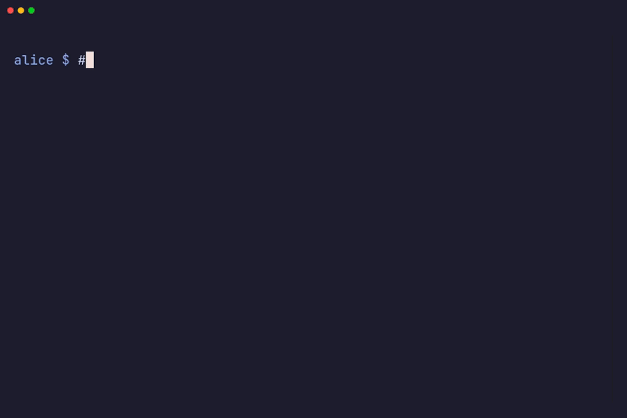

In murk, each teammate has their own key. Adding or removing someone is a
normal change to the vault file, tracked in git. There is no shared password
to rotate and no secrets server to run.

Two rules apply to every change to the recipient list:

- Removing someone also needs rotation, because they can still decrypt old
  versions of the vault from git history. See [offboarding a
  teammate](/guides/offboarding/).
- Make recipient changes on the main branch. When both branches changed the
  vault, a recipient change on only one side is a merge
  [conflict](/guides/git-merge-ssh/#conflicts) that you resolve by hand.



## Adding a teammate

Each person has their own key. The handoff takes four steps:

1. Alice creates the vault and commits it:

   ```bash
   murk init
   murk add DATABASE_URL
   git add .murk && git commit -m "add vault" && git push
   ```

2. Bob clones the repository and runs `murk init` once in his clone. It
   creates his key, or reuses the key he already has for this vault. He is
   not authorized yet, so it prints his public key. He sends that key to
   Alice.

   ```bash
   murk init
   ```

3. Alice authorizes the key, then commits and pushes. This re-encrypts the
   shared secrets to include Bob's key.

   ```bash
   murk circle authorize age1bob... --name bob@example.com
   git commit -am "authorize bob" && git push
   ```

4. Bob pulls. murk refuses the vault on his machine until he trusts it. He
   reviews the vault and runs `murk trust` once (see [Trusting the vault on a
   new machine](#trusting-the-vault-on-a-new-machine)). Then he can read the
   shared secrets:

   ```bash
   git pull
   murk trust
   murk get DATABASE_URL
   ```

Bob can also keep his own local overrides on top of the shared secrets. See
[shared, group and private secrets](/guides/shared-vs-scoped/):

```bash
murk add DATABASE_URL --group me
```

## Trusting the vault on a new machine

A signed vault proves that a recipient wrote it. But the vault lists its own
recipients, so murk must also know whose signature *this machine* accepts.
murk keeps that decision in a local trust pin, outside the repository. The
first time Bob loads the vault, murk refuses it with "not trusted on this
machine yet" and shows who signed it:

```bash
git log -p -- .murk    # who changed the vault, and how
murk diff ORIG_HEAD    # after a pull: the changes it brought in, decoded
murk trust             # show the signer, its signing-key fingerprint and every recipient, then ask
```

A plain `murk diff` compares with `HEAD`. Right after a pull, `HEAD` is the
pulled commit, so a plain `murk diff` shows nothing. git sets `ORIG_HEAD` to
your commit from before the pull or merge, also when it fast-forwards. So run
`murk diff ORIG_HEAD` right after the pull, before another pull, merge,
rebase or reset moves it. A fresh clone has no earlier commit. A newly
authorized teammate's key also cannot open the revisions from before they
were authorized. In those cases, read `git log -p -- .murk` and the output of
`murk trust`.

`murk trust` prints the signer's full key and signing-key fingerprint. It
marks each recipient that is new since this machine last trusted the vault.
Check the signer's fingerprint with Alice, over a channel other than the
repository. This first check is a human decision, and every check that murk
makes afterwards depends on it. In a script, pass `--yes` after you review
the vault.

You run `murk trust` once per vault on each machine. You run it again each
time murk refuses a vault and you have reviewed the reason. murk refuses:

- an unsigned vault,
- a signature from a key that this machine does not trust,
- a teammate's signing key that this machine has not confirmed yet,
- an older revision,
- the file of another vault,
- a group membership change that a member of that group did not sign.

A switch to an older branch is not a rollback, because each branch keeps its
own save counter. Loading an older branch, a detached HEAD or an unmerged
pull request never changes which signers this machine trusts. Only three
things do that: `murk trust`, your own saves, and a newer vault on a branch
this machine accepted before. So when you review a pull request that
authorizes someone, this machine does not start to trust them.

After you run `murk trust`, murk accepts your teammates' ordinary writes
with no prompt. The signer is in the set that this machine trusts, and the
machine already knows its signing key. A newly authorized teammate's first
write is the exception (see below). See [Recipients &
signatures](/concepts/recipients-signatures/#trusting-a-signer) for the full
rules.

CI runners have no trust pin. Give them `MURK_TRUSTED_SIGNERS` instead, with
the entry that `murk trust --print-key` prints for each signer (see
[CI/CD](/guides/cicd/)).

### A new teammate's first write

When Bob has an age key, his first write after he is authorized carries a
signing key that no other machine has seen. Each of those machines refuses
that write once ("a trusted recipient whose signing key this machine has not
confirmed yet") and shows the fingerprint of the key.

1. Bob runs `murk trust --print-key`, which prints his own signing-key
   fingerprint. While he is not authorized, `murk init` shows the same
   fingerprint next to his public key, so he can send both together.
2. Alice and every other teammate compare it with the fingerprint in their
   refusal, over a channel other than the repository. Then they run
   `murk trust`.

This is trust on first use. The key arrives inside the vault, so the
fingerprint comparison is the check. After that, murk pins Bob's key. It
refuses a different key for Bob as a forgery, and `murk trust` does not
accept that key. When a teammate who confirmed the key writes the vault,
their signed vault carries the key. Machines that load that vault then learn
Bob's key with no prompt.

If Bob uses an `ssh-ed25519` key, nobody needs to confirm anything. That is
the case, for example, when Alice runs `murk circle authorize github:bob`.
His recipient string is his verifying key.

## Teams with hardware or `ssh-rsa` keys

Hardware keys and `ssh-rsa` keys cannot sign. A teammate who uses one writes
the vault unsigned, and the machines of signing teammates refuse it. A
signing teammate reviews the change and runs `murk trust`. That re-signs the
vault with their key, and they commit the result. A machine that sets
`MURK_TRUSTED_SIGNERS` refuses an unsigned vault, whatever its own key can
do. See [Hardware-backed keys](/guides/hardware-keys/#mixed-teams).

## Authorizing via GitHub

:::caution[Experimental]
GitHub recipients (`github:`) are experimental. murk fetches GitHub keys over the network and trusts them on first use, so confirm the keys belong to the person you mean.
:::

Instead of an age key exchange, you can authorize a teammate by their GitHub
username:

```bash
murk circle authorize github:bob
```

This fetches Bob's SSH public keys from `https://github.com/bob.keys`, which
needs no authentication. It adds every `ssh-ed25519` key on the account as a
recipient, so nobody pastes an age public key into a chat. It skips `ssh-rsa`
keys with a warning unless you pass `--allow-ssh-rsa`. It fails if every key
is RSA. `ssh-ed25519` keys sign directly, so teammates added this way need no
signing-key confirmation.

Bob decrypts with the matching private key. He sets `MURK_KEY_FILE` to it,
for example `~/.ssh/id_ed25519`. murk does not search `~/.ssh` on its own.
It needs an unencrypted SSH private key that only Bob can read. It cannot
read a key that has a passphrase. If Bob has no such key, use the age key
exchange above.

### GitHub key fingerprints

The first successful `murk circle authorize github:bob` records the SHA-256
fingerprints of the fetched keys in the encrypted vault metadata. If Bob's
GitHub keys change later, the next `authorize github:bob` does not continue
silently. It shows the difference and needs `--force` to accept the new
keys. This catches a normal key rotation and also a compromised GitHub
account that adds an attacker's key. In both cases, a person must confirm
the change.

This check trusts GitHub as a key directory. It also trusts that the
username belongs to the person you think it does. Treat
`authorize github:user` with the same care as every other access grant. For
sensitive vaults, confirm the identity through a separate channel. See the
[threat model](/security/threat-model/) for the full trust analysis.

## Listing and managing recipients

```bash
murk circle                    # list recipients
murk circle revoke RECIPIENT   # a public key, a display name or github:user (see offboarding)
```

murk compares keys by their canonical spelling. So `authorize` refuses a
second spelling of a key that is already a recipient, and `revoke` removes
every spelling of a key. murk refuses an `age1...` key with a non-canonical
encoding (the high bit of its value set), so it cannot act as an alias that
survives a revocation.

To share a secret with only part of the team, use a group (experimental):

```bash
murk group create ops
murk group add ops --member bob@example.com
murk add STRIPE_KEY --group ops
```

`murk group ls` lists groups, and `murk group rm ops --member bob@example.com`
removes a member. `murk circle authorize ... --group ops` adds a new
recipient to a group in the same step. See [shared, group and private
secrets](/guides/shared-vs-scoped/) and the [CLI
reference](/reference/cli/#murk-group) for all the flags.

A member of a group must sign each change to that group's membership. A
machine that has pinned the earlier membership refuses a change that anyone
else made, until you review it and run `murk trust`. For the same reason,
`murk group rm NAME` needs you to be a member of the group. The merge driver
also refuses a merge that changes a group's membership when the merging key
is not in that group. A member must do that merge (see [the merge
driver](/guides/git-merge-ssh/)).

## Upgrading to 0.14

0.14 changes how murk signs and trusts vaults, so murk 0.13 and earlier
cannot read a vault that 0.14 wrote. Upgrade everyone who writes or reads
the vault, and CI, before the first 0.14 write reaches the shared branch.
Also upgrade the Python and Node bindings of apps that read the vault. A
binding older than 0.14 fails with `unsupported vault version`, not with a
trust error (see [bindings errors](/reference/bindings/#errors)).

1. On each machine, murk refuses the first load of an existing vault once,
   with "not trusted on this machine yet" and the current signer. Review the
   history (`git log -p -- .murk`, and `murk diff REF` against the last
   revision you reviewed), then run `murk trust`. A 0.13 pin carried no
   trust, so everyone does this once.
2. The first 0.14 save adds a vault id and a save counter, and re-signs the
   vault in the new format. A vault from 0.13 has no id, so murk derives one
   from the `created` timestamp and the name of the vault. Every copy derives
   the same id, so teammates who upgrade on different days still agree.
   Under 0.13 you could make a vault by copying another one (staging copied
   from prod, for example). Such a copy derives the same id as the original,
   so murk cannot tell the two apart by id. murk would accept the copy in
   place of the original when the copy's save counter is higher.
3. murk refuses a vault that 0.13 signed only on a branch where this machine
   already accepted or saved a 0.14 vault. The refusal says that the vault
   is "in the pre-0.14 format". Everywhere else, the vault loads as history.
   That includes a branch that never saw 0.14, and a detached HEAD. History
   can make the set of signers this machine trusts smaller, never larger.
   After this machine has seen a 0.14 vault, that history is also read-only.
   murk refuses every write over it until you accept that copy (step 5). So
   trust once first, then make the first 0.14 save. On a branch that has
   seen 0.14, murk does not accept a write from a teammate who still uses
   0.13.
4. Make the first 0.14 save on the default branch and commit it. Then merge
   it into your other branches. All worktrees of a repository share one pin,
   but the 0.13 rules apply per branch. A save on one branch does not make
   another branch refuse its committed 0.13 vault. A branch gets its 0.14
   mark only when this machine saves on that branch. A merge of the upgrade
   into the branch does not give it the mark. Until this machine saves
   there, an older 0.13 revision checked out on that branch still loads,
   read-only.
5. On a branch with a 0.13 vault that this machine has not accepted, murk
   refuses every write. The message says that the vault "is in the pre-0.14
   format on a branch that hasn't taken the upgrade, and this machine hasn't
   accepted this copy, so it is read-only here", and that murk wrote
   nothing. To continue, merge the upgrade from the default branch, then
   save. Or review the file (`git log -p -- .murk`, `murk diff`) and run
   `murk trust --vault .murk` on that branch to accept this copy. The next
   write upgrades the vault and gives the branch its 0.14 mark, so commit
   the result. Any change to the accepted file makes it a different copy,
   which is read-only again. On a detached HEAD, check out a branch first. A
   machine that ran murk 0.14.0 has no accepted copies, so it also needs
   `murk trust` for its first write over a 0.13 file.
6. On a branch that already has a 0.14 mark, murk refuses a 0.13 vault
   outright ("has already been upgraded on this branch"). The file is older
   than the vault this machine accepted there. If it is an older revision,
   switch back to the newer one. Otherwise, commit the 0.14 upgrade on the
   default branch and merge it. Or run `murk trust --vault .murk` to accept
   this copy, then commit the result.
7. While this machine has not seen a 0.14 vault, the merge driver cannot
   tell an older 0.13 revision from a newer one. So make the first 0.14 save
   before you merge branches that still have 0.13 vaults. After that, the
   driver refuses a 0.13 side that you have not accepted with `murk trust`.
   It then writes nothing, and git keeps our side. A 0.13 common ancestor
   with two 0.14 sides still merges. When one side is 0.14, the driver
   refuses a 0.13 side that changed the vault.
8. Give CI `MURK_TRUSTED_SIGNERS`. See [CI/CD](/guides/cicd/#upgrading-to-014).
9. Run `murk setup-merge-driver` again in each clone, so that the driver
   gets the vault path. See [the merge driver](/guides/git-merge-ssh/#upgrading-an-older-driver-config).
10. If part of your team uses hardware or `ssh-rsa` keys, read the section
    above. Their writes are unsigned until a signing teammate runs
    `murk trust`.
