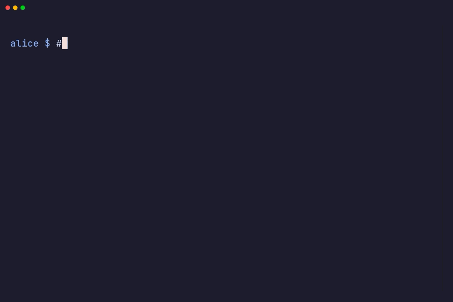

import { Steps } from '@astrojs/starlight/components';

You've been invited to a project that uses murk for secrets. Here's how to get
set up. Starting a project of your own? See
[Start a new vault](#start-a-new-vault).

<Steps>

1. ## Install murk

   ```bash
   brew install interrupted-sh/tap/murk
   ```

   Or use `cargo install murk-cli`, or download a binary from
   [GitHub Releases](https://github.com/interrupted-sh/murk/releases). See
   [Install & verify](/install/) for every install path and how to verify a
   release.

2. ## Generate your key

   Clone the repo and change into it. Run `murk init` next to the `.murk`
   file. In a directory without a `.murk` file, `murk init` creates a new,
   unrelated vault.

   ```bash
   murk init
   ```

   murk generates a key for this vault, prints 24 recovery words, and prints
   your public key:

   ```
   ⚠ not authorized — share your public key to get added:
     age1…
     signing key SHA256:… — teammates confirm this on your first write
   ```

   If `MURK_KEY` or `MURK_KEY_FILE` is already set in your shell, or murk
   already stores a key for this vault, murk uses that key instead of
   generating one. It then prints no recovery words. Unsetting the variable
   gives you a new key only if murk stores no key for this vault.

   **Write the recovery words down.** If you lose your key, these words are
   the only way to recover it. See [Key recovery](/guides/recovery/). Copy the
   `age1…` line for step 3.

   If you lose the `age1…` line, run `murk init` again in the same directory.
   It reuses your stored key and prints the same public key. It never
   replaces a key that is already stored.

   murk stores your key in `~/.config/murk/keys/`, not in the repo. It also
   writes a `.env` file that points at the key. Make sure `.gitignore` lists
   `.env` and `.murk.lock` (the empty lock file murk creates next to the
   vault on every write).

3. ## Get authorized

   Send your `age1…` public key to someone who can already decrypt the
   vault. They run:

   ```bash
   # (run by a current recipient, not you)
   murk circle authorize age1… --name you@example.com
   ```

   Then they commit and push `.murk`.

   **Confirm your signing-key fingerprint (age keys only).** Your first write
   after you are authorized is refused once on each teammate's machine. It
   stays refused until that teammate confirms the key you sign with:

   - `murk init` printed your fingerprint (`signing key SHA256:…`). To see it
     again, run `murk trust --print-key`. It prints your signer entry on
     stdout and the fingerprint on stderr.
   - Read the fingerprint to each teammate over something other than the
     repo.
   - Each teammate compares it with the one `murk trust` shows, then accepts.

   You do this once per teammate. An `ssh-ed25519` key, including one added
   with `github:`, is its own verifying key and skips this step.

   **Using a GitHub SSH key instead.** If you have an ed25519 SSH key on
   GitHub, a recipient can add it without exchanging keys. They run
   `murk circle authorize github:YOUR_USERNAME`, then commit and push
   `.murk`. murk adds your GitHub SSH public keys as recipients and skips RSA
   keys.

   :::caution[Experimental]
   `github:` recipients are experimental. murk fetches the keys from GitHub
   over the network and trusts them on first use. The recipient must confirm
   with you that the keys are yours. See
   [Authorizing via GitHub](/guides/teams/#authorizing-via-github).
   :::

   

   On this path your SSH key is your murk identity, so you do not need the
   key from step 2. murk does not look in `~/.ssh` on its own. After you
   `git pull`, point murk at your SSH private key:

   ```bash
   unset MURK_KEY
   export MURK_KEY_FILE=~/.ssh/id_ed25519
   ```

   The key must be unencrypted (no passphrase) and readable only by you.
   Until murk finds it, `murk get`, `murk export` and `murk exec` fail:

   - With no key at all, they fail with "MURK_KEY not set".
   - With a key that is not a recipient, such as one from `murk init`, they
     fail with "you are not a recipient of this vault".

   If your GitHub keys change later, the next `authorize github:YOUR_USERNAME`
   refuses and lists the added and removed keys. The recipient must review
   them and pass `--force`.

4. ## Pull and trust the vault

   Once authorized:

   ```bash
   git pull                    # get the updated .murk file
   murk trust                  # once per machine: review the signer, then accept
   ```

   `murk trust` prints who signed the vault and every recipient, then asks
   before it records anything. For the signer it shows the full key and its
   signing-key fingerprint. Check that fingerprint with the person who
   invited you, over something other than the repo. To see what changed
   first, run `git log -p -- .murk`. On a machine that already trusts the
   vault, `murk diff ORIG_HEAD`, run right after a pull, shows what the pull
   changed.

   If you skip this step, murk refuses the first load on a machine with "not
   trusted on this machine yet". murk records your answer on this machine,
   not in the repo. It asks again only if a later vault looks wrong:
   unsigned, signed by an unfamiliar key, or older than one you have already
   accepted. See [Recipients &
   signatures](/concepts/recipients-signatures/#trusting-a-signer) for the
   rules.

   Do this once on every machine, after every fresh clone, because the trust
   pin lives outside the repo. A CI runner has no pin and nobody to run
   `murk trust`. Set `MURK_TRUSTED_SIGNERS` on it instead, next to the key.
   Its value is the entry that each signer's `murk trust --print-key` prints,
   separated by commas or newlines. See [CI/CD](/guides/cicd/).

   Set `MURK_TRUSTED_SIGNERS` only from a CI secret or the real process
   environment. Never set it from a file in the repository or a `.env` that
   an app's dotenv loader reads, because it decides which signers the
   machine trusts.

5. ## Use secrets

   ```bash
   murk ls                     # see what secrets are available
   murk get DATABASE_URL       # print one secret
   murk export                 # print all as shell exports
   murk exec -- ./my-script.sh # run a command with secrets in env
   ```

   See the [CLI reference](/reference/cli/) for every command and flag.

6. ## Set up direnv (optional)

   ```bash
   murk env
   direnv allow
   ```

   Now secrets are automatically loaded when you `cd` into the project. See
   [direnv integration](/guides/direnv/) for how it works and how to keep it
   in sync as secrets change.

</Steps>

## Start a new vault

Run `murk init` in a project directory that has no `.murk` file. murk asks
for your name or email and creates the vault with you as its first
recipient. It prints your recovery words: write them down. If `MURK_KEY` or
`MURK_KEY_FILE` is set, or murk already stores a key for this vault (here or
in another git worktree of the repo), murk uses that key and prints no
recovery words.

Then add secrets, keep the local files out of git, commit the vault and load
it with direnv. `murk init` writes no `.gitignore`. Its `.env` points at your
key, and every write creates an empty `.murk.lock` next to the vault.
Neither belongs in git.

```bash
murk init
murk add DATABASE_URL   # prompts for the value (hidden input)
printf '.env\n.murk.lock\n' >> .gitignore
git add .murk .gitignore && git commit -m "add secrets vault"
murk env
direnv allow
```

To add a teammate, run the `murk circle authorize` command from step 3, then
commit and push `.murk`.

For separate development, staging and production secrets, create one vault
for each environment, for example `murk init --vault prod.murk`. `murk init`
offers to reuse the key you already have. See
[Environments](/guides/environments/).

## What to know

- Secret names are public. Anyone with repo access can see what secrets exist
  (for example `STRIPE_KEY`) and their descriptions. Only values are
  encrypted.
- Your key is your identity. Do not share it, paste it into chat or commit
  it.
- Your 24 recovery words rebuild your key. Anyone who has them has your key,
  so store them as carefully as the key itself. See
  [Key recovery](/guides/recovery/).
- Revoking someone does not erase history. A teammate who leaves can still
  decrypt every vault version they could read before. The team rotates those
  secrets after revoking them. See [Offboarding](/guides/offboarding/).
- Trust is per machine. murk checks every vault against what your machine
  has accepted, so it refuses a file copied over the vault or an older
  revision. Pass `--yes` to `murk trust` only in scripts, after you review
  the vault.
- A vault cannot set sensitive variables. `murk export`, `exec` and
  `agent exec` refuse a key named like `PATH`, `LD_PRELOAD`, `GIT_*`,
  `HTTPS_PROXY` or `MURK_*`, because whoever last wrote the vault chose those
  names. Review who added the key, then pass `--allow-reserved` if you mean
  it. See
  [Environment variables](/concepts/env-vars/#variable-names-a-vault-may-not-set).
